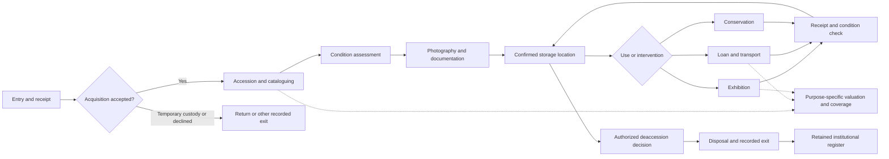

# Domain and workflow model

This is a proposed model for the approved audit scope. Accepted user decisions are listed separately from redesign proposals. It is not a replacement schema or an assertion of Spectrum compliance. The [Spectrum 5.1 procedure list](https://collectionstrust.org.uk/spectrum/procedures/) is a coverage reference; each institution still sets its documentation, approval, retention and legal policies.

## Accepted constraints

- Museums drive the product; library circulation remains optional and has separate item/copy/borrower semantics.
- Support both small teams with combined roles and larger collections with separated approvals, sites and responsibilities.
- Existing institutional records and accession history are permanent. Use additive migrations, preserve identifiers and evidence, and withdraw/archive with restore.
- Publishing an object does not publish its attachments. Each public image needs explicit file approval and a public rendition. Unknown/restricted rights and operational documents remain private by default.
- The user selected preservation of environmental ingestion using credentials bound to a device, organization and location, described temperature/humidity webhooks, and then identified Tuya as the planned sensor ecosystem. Exact devices/current live status remain unverified. Sender payload/authentication is a pre-cutover dependency for any existing integration.
- No country-specific compliance, retention period or accreditation claim is assumed.

## Proposed vocabulary

Use these meanings in interface labels and domain contracts before considering physical table renames. Renaming `collections` everywhere would add migration risk without itself correcting the behavior.

| Term | Proposed meaning | Current ambiguity or consequence |
| --- | --- | --- |
| Organization / institution | Tenant responsible for the institutional record and its access policy | Not equivalent to a building, site, public portal, or an object's historical owner |
| Site | Physical or operational institution subdivision | Site access policy should be explicit; public-portal entitlement should not accidentally define site management |
| Object | Stable catalogued identity for a museum item or institution-defined aggregate | Stored in `collections`; retain its ID through loans, exhibitions, withdrawal and disposal |
| Collection / collection group | Curatorial grouping of objects, with explicit primary/secondary membership if needed | Current object/group terminology and overlapping association fields need one authoritative rule |
| Location | Physical place, container or transit/external custody reference with known scope | Empty location must mean unknown/unassigned, not implicitly loaned or returned |
| Party | Person or institution in a contextual relationship | Staff login, donor, lender, depositor, appraiser and historical owner are roles, not necessarily separate identities |
| Entry | Receipt into institutional custody for a stated purpose | Can precede or never result in acquisition; supports deposit, identification and incoming loan |
| Acquisition | Decision and evidence establishing the institution's interest/title, under its policy | Physical possession alone is insufficient; this should not be inferred from a location update |
| Accession | Controlled registration of accepted permanent collection material | Identifier/history remains permanent; not a synonym for any temporary catalog record |
| Cataloguing | Description and documentation of the object | Can continue after accession; does not confer title or prove custody |
| Custody | Accountable possession/control, including external parties and transit | Requires a handoff, not just a workflow status or date range |
| Movement | Authorized, recorded change of physical location/custody | Request approval and actual execution are distinct; record the observed source at execution |
| Loan | Agreement for temporary custody with per-item dispatch and return | Museum loan is distinct from library circulation; incoming return is an exit to lender, not deaccession |
| Exhibition | Event/case with many object participants and a schedule | Approval, public schedule, installation and physical return are separate facts |
| Condition assessment | Dated evidence about an object's physical state | Pre/post-loan, installation, intake and treatment assessments should not overwrite each other |
| Conservation treatment | Planned/authorized intervention with evidence and outcome | Completion should link to an assessment, not silently replace historical condition descriptions |
| Provenance | Evidence-backed claims about an object's history with uncertainty recorded | Preserve original assertions even when a new interpretation supersedes them |
| Valuation / appraisal | Dated value for a specified purpose, currency and assessor | Latest date, manually marked current and specialized value fields need consistent purpose-specific rules |
| Insurance coverage | Effective policy commitment against one typed target per coverage row | Active flag alone does not establish dates, scope or sufficient cover |
| Exit | Recorded physical release to a recipient | May be temporary or permanent and may not involve deaccession |
| Deaccession | Authorized removal from the permanent collection under institutional policy | Separate decision from disposal execution and physical exit; never erase its register evidence |
| Withdrawal / archive | Removal from routine operational views with retained institutional record and restore | Not an assertion that title changed or that disposal took place |
| Digital asset / document | Evidence or descriptive file attached to a controlled context | Storage URL availability does not imply permission to disclose or publish |
| Public rendition | Approved derivative for public display, tied to a version and rights decision | Original and operational attachments remain separately controlled |
| Case / task | Coordinated procedure and its actionable work item | A task completion must not automatically attest physical receipt or legal approval |

## One object through the whole lifecycle

The object ID anchors the record. Cases, parties, assessments, assets and events link to that identity rather than creating new versions of the object at every module boundary. Some objects enter custody without accession; some accessioned objects are never exhibited or loaned.

This diagram expresses the proposed handoffs. It does not require every institution to perform every step or treat documentation and valuation as strictly sequential.

| Handoff | Existing useful behavior | Audit gap | Desired complete contract | Recommendations |
| --- | --- | --- | --- | --- |
| Receipt → acquisition/temporary custody | Accessions capture source/method/docs and object drafts | No complete general entry/exit path found; title and custody conflated | Entry receipt and temporary identity; review/title evidence; branch to accession or return | R18, R21 |
| Acquisition → accession → catalog | Approval can publish a draft into an object | Draft bypasses source verification; draft fields do not match direct catalog fields | One shared draft with accession policy enforced at finalization and identifier assigned once | R07, R09, R24 |
| Accession → documentation/condition | Rich object fields, media and treatment modules | Staff assemble assessment/photography/catalog work across modules | Case-linked required/recommended tasks, retained evidence and completion status | R17, R22, R28 |
| Catalog → storage/movement | Hierarchy, movement requests and ordinary history | Bulk/exhibition paths bypass history; references can cross tenants | Authorized destination and observed source; executed event plus current-location projection in one transaction | R04, R10 |
| Storage → loan/exhibition | Agreement/participant/task/transport records exist | Exhibition anchor/join competition; no structured loan home-location snapshot | Canonical membership, custody plan, dispatch assessment, origin snapshot and explicit handoff | R08, R10, R16, R17 |
| Dispatch → shipment/install | Transit and installation tasks exist | Receipt/install/closure facts can be inferred inconsistently | Arrival, acceptance and installation are separately recorded with staff and condition evidence | R10, R17, R22 |
| Loan/exhibition → return/storage | Return actions and condition reports exist | Loan returns diverge; exhibition closure can imply unconfirmed return | Per-item confirmed receipt, assessment, destination; case closes only when items/exceptions reconciled | R08, R10, R17 |
| Assessment → conservation → reassessment | Treatment lifecycle and schedules | Current condition and treatment result disconnected | Referencing baseline/after assessments; approved treatment and follow-up tasks | R17, R22 |
| Valuation → insurance/report | Appraisals/policies/coverage/alerts exist | Multiple current-value definitions, target/currency/effective-date ambiguity | Purpose/currency/date valuation; explicit covered target and effective interval; no unsupported combined total | R19, R29 |
| Deaccession → disposal/exit/archive | Methods, appraisals, proceeds and regulatory flags exist | Readiness advisory; hard deletion destroys evidence; incoming return misclassified | Stage-specific approval/exit/proceeds evidence and permanent linked register | R05, R08, R09, R21 |

## Repeated entry and competing facts

| Information | Current repetition or competing sources | Proposed owner and reuse |
| --- | --- | --- |
| Object descriptive fields | Accession draft has a smaller field set than catalog; downstream forms request existing details | Shared validated object draft; review newly required fields at cataloguing without retyping captured data |
| Source/donor/owner/lender contacts | Free-text fields, donors, accounts, contacts and ownership chains | Party authority record with contextual role and immutable historical display snapshot |
| Object location | Ordinary movement, bulk edit, loan, exhibition and transfer each write it | Physical movement/custody command owns current projection and evidence |
| Condition | Embedded object description/history, loan reports, exhibition and treatment state | General dated assessments; current-condition projection references accepted assessment |
| Exhibition/group membership | Anchor/primary association plus join records | Canonical memberships; optional primary role explicitly defined |
| Current valuation | Appraisal flags, latest-by-date selection, specialized object value fields | Purpose-specific appraisal projection; preserve source assertions and supersession |
| Activity history | Entity arrays, audit rows and movement/treatment/loan histories | Correlated append-only events with retained actor/subject snapshots and links to original evidence |
| Published image | Public object flag, rights/category/high-resolution flags, original storage URL | Approved file/version/rendition projection checked by every public consumer |
| Dashboard/report totals | Counter rows and scans with differing status/date meanings | Defined metric contract and maintained/reconciled projection, including as-of timestamp |

Do not auto-merge parties, renumber duplicate accessions, infer missing locations or rewrite historical ownership while normalizing. Produce a review queue and keep original values.

## Automation boundaries

Automation should create reliable preparation and evidence trails. It should not invent physical facts or legal authorization. A transactional domain event can update dependent projections; asynchronous notifications/delivery need durable identity and retry handling.

| Trigger | Safe transactional result | Follow-up work or notification | Human/evidence gate |
| --- | --- | --- | --- |
| Accepted accession | Stable object/number link, retained source decision, audit event | Propose catalog, condition, photography and location tasks once | Approval/source requirements and distinct permissions |
| Executed movement | Custody event and current location from observed state | Notify relevant custodian if configured; update case progress | Source conflict, destination access and custody occupancy revalidated |
| Loan approved | Approved agreement and per-item preparation requirements | Packing, condition, insurance and transport tasks | No automatic dispatch or physical receipt |
| Loan item dispatched/returned | Item custody state, assessment links, timestamp/destination; reconcile parent | Outstanding-item reminders; discrepancy review | Staff confirms each handoff; condition text is not the return flag |
| Exhibition installed/deinstalled | Participant state and explicit movement events | Installation/return task progress, due alerts | Case closure cannot mark unreceived items returned |
| Accepted assessment | New immutable evidence and current-condition projection | Propose conservation review for institution-defined concern | Assessor sign-off; uncertain historical assessments remain marked uncertain |
| Treatment completed | Outcome/after-assessment link and retained treatment evidence | Follow-up inspection and valuation/insurance review if needed | No invented restored condition or monetary value |
| Authenticated sensor reading | Deduplicated measurement with device/time/units/location evidence | Open/update one alert episode; escalations respecting policy | Device credential and binding; out-of-order/late data handled explicitly |
| Media approved/unpublished | Version-specific public rendition availability and audit | Review reminders for rights expiry; invalidate cached public projection | Authorized per-file approval; rights change invalidates unsafe publication |
| Policy/loan due date approaching | Durable due event identity | Preference-aware reminder/escalation with delivery result | Expiry does not prove item return or terminate custody by itself |
| Deaccession decision approved | Approved decision and required next steps | Disposal, exit/recipient and proceeds tasks as applicable | Method-specific stages; do not require future sale evidence before authorization |
| Object withdrawn/restored | Retained ID/evidence, archive state and audit event | Review active dependencies/blockers | Withdrawal is not disposal; restoration must respect case/custody conflicts |

## Measurement types and webhook contract

The schema already permits temperature, relative humidity, light level and UV level. Temperature/humidity support and preservation of any live sender are the required scope. Light and UV support can use the same registered-device measurement framework when a real device and its units/threshold policy are configured. [Testo's museum guidance](https://www.testo.com/en-UK/applications/museums-and-archives) describes these environmental measurements; this is not a recommendation to buy particular equipment.

Tuya is the user's planned ecosystem. Its documented cloud message service uses a Pulsar SDK and encrypted/signed message envelopes; it is not sufficient to assume every Tuya sensor can directly POST to a custom endpoint. See [Tuya's device message subscription](https://developer.tuya.com/en/docs/iot/subscribe?id=Kbwtw7fhhjabw) and [Smart Home cloud setup](https://developer.tuya.com/en/docs/iot/smart-home-quick-start?id=Kbvwrxn6mngbd). Proposed integration: a verified Tuya/gateway adapter normalizes model-specific measurements, then forwards them to the scoped HTTPS receiver. This is an architectural inference, subject to the selected Tuya product/cloud service. Do not advertise a built-in Tuya connector until that adapter is fully implemented and tested.

Before changing a live sender, confirm manufacturer/gateway, current receiver, payload version, device identity, reading identity or stable deduplication key, event timestamp, temperature unit, humidity unit, supported signing/header authentication, retry behavior, offline buffering and clock drift. Validate acceptable ranges without dropping truthful extremes merely because they cross alert thresholds. Preserve original observation time and received time. A gateway with many probes must bind each probe explicitly; a shared credential must not let the payload select an arbitrary institution/location.

No environmental webhook receiver was found in the inspected `packages/backend/convex/http.ts`. This does not disprove the user's live integration: its gateway/receiver may be external or deployed from another revision. Outgoing webhook configuration in this repository is a separate concern.

## Decisions required for later redesigns

These questions do not block delivery of the audit. Resolve each before implementing its dependent batch and record accepted tradeoffs in a project ADR only when warranted.

| Decision | Recommended direction | Needed before |
| --- | --- | --- |
| Accession identifier policy | Tenant/register-scoped uniqueness, preserved historical identifiers and reviewed duplicate exceptions | Batch 2 |
| Acquisition and disposal approvals | Institution-configurable stage requirements, role separation where needed, audited exceptions | Batch 2 and extended Batch 5 |
| Loan/custody handoffs | Per-item states, observed physical receipt, explicit return destination, separate incoming exit | Batch 3 |
| Exhibition/group membership | One authoritative membership relation; optional primary role defined separately | Batch 3 |
| Accepted condition assessment | Dated evidence with directional links and sign-off; current condition is a projection | Batch 3 |
| Metric definitions and scale | Agreed active/current/date exclusions, as-of time, target object/user/job volumes | Batch 4 |
| Party/provenance normalization | Preserve original claims/text; reviewed merge, uncertainty and partial dates | Batch 5 |
| Coverage/value purpose | One coverage target, effective intervals, values grouped by currency unless explicit conversion exists | Batch 5 |
| Sites, permissions and commercial entitlements | Explicit independent policy dimensions, agreed existing-customer migration | Batch 6 |
| Notification and delivery policy | Category-aware preferences, defined digests/escalation, durable delivery and alert episodes | Batch 7 |
| Field/offline and emergency features | Supported devices, conflict/security model and institution-approved procedures | Batch 8 |

Batch 1's public-file and archival decisions are already approved. The Tuya model/gateway and sender contract remain integration details required before deploying a sensor cutover. A complete generic authenticated receiver can be implemented/tested without claiming vendor connectivity or collecting credentials during this audit.
